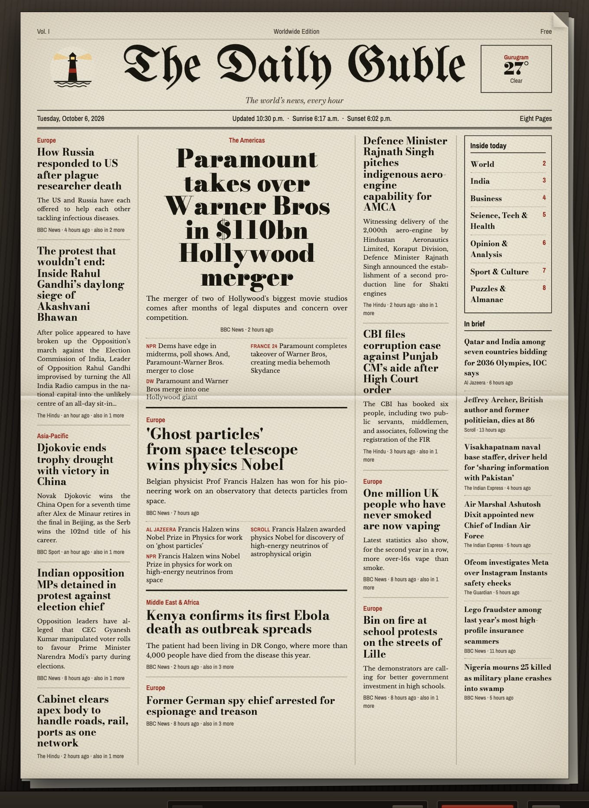

<p align="center">
  <picture>
    <source media="(prefers-color-scheme: dark)" srcset="brand/guble-wordmark-dark.svg">
    
  </picture>
</p>

<p align="center"><b>The Daily Guble</b>: a newspaper you read like paper.<br>
<a href="https://dailyguble.pages.dev">dailyguble.pages.dev</a></p>

<p align="center"></p>

# The Daily Guble

A newspaper website that looks and feels like a real paper. Readers turn the pages
by dragging them, fold the paper in half, zoom in, read any story in large type,
and play the crossword, sudoku and word search right on the page. The date,
sunrise, tides and weather fill themselves in every day.

Editors sign in with a password and change everything from the browser: stories,
photos, pages, columns, games and the look of the paper. One click publishes the
new edition, and it can go out to free web hosting.

**Contents**

- [Quick start](#quick-start)
- [For readers](#for-readers)
- [Live dates, sun, tides and weather](#live-dates-sun-tides-and-weather)
- [For editors: the newsroom](#for-editors-the-newsroom)
- [Publishing the public website for free](#publishing-the-public-website-for-free)
- [Running it](#running-it)
- [Settings (`.env`)](#settings-env)
- [Security](#security)
- [Privacy](#privacy)
- [Your data and backups](#your-data-and-backups)
- [Troubleshooting](#troubleshooting)
- [Brand](#brand)
- [For developers](#for-developers)

---

## Quick start

```sh
./run.sh
```

- **Open the paper:** <http://localhost:8080>
- **Open the newsroom (editor):** <http://localhost:8080/admin>. The username is `editor`.
- **First run:** if no password has been set yet, `run.sh` asks you to choose one, at least 12 characters.

`run.sh` uses Node.js (version 20 or newer) if you have it, and Docker if you don't.

---

## For readers

### Turning pages and moving around

| To do this | Do this |
|---|---|
| Turn the page | Drag the page sideways like real paper, use the ← → buttons, or press ← → on the keyboard |
| Turn with the corner | Hover a bottom corner to see it curl, then click it |
| Jump to the first or last page | Home / End keys |
| Zoom in or out | Pinch, scroll, the + and − buttons, or the + and − keys |
| Zoom into one column | Double-tap or double-click it. The text fills the screen at a comfortable size. Do it again to zoom back out. |
| Move around when zoomed in | Drag the paper |
| Back to the whole page | **Fit** button, or the 0 key |
| Fold the paper in half | **Fold** button, or the F key. The paper shows only what's above the fold, with a crease, like a paper on a newsstand. |

A short tip appears on a reader's first visit explaining tapping and double-tapping.

### Reading a story in large type

- **Open a story:** tap or click it. It opens on a clean sheet of newsprint in large, easy-to-read type, with its headline, photo and byline.
- **Move between stories:** swipe left or right, use the arrow buttons, press ← →, or tap **Next story** at the bottom. This goes story by story through the whole paper.
- **Close the story:** press Esc or ×.
- **Without tapping:** the red **Read** button opens the first story on the current page.

### Puzzles

Tap a puzzle and the paper zooms in so the grid is easy to use. Progress is saved
on the reader's own device, so they can come back to it later. If the editor
changes the puzzle, saved progress for it starts fresh.

**Crossword**
- **Type:** tap a square and type. The cursor moves along the word as you go.
- **Switch direction:** tap the same square again, or press Space, to flip between Across and Down.
- **Move around:** Tab or Enter jumps to the next clue (Shift+Tab goes back), and the arrow keys move square by square. Tap a clue in the list to jump to it.
- **Buttons:** **Check** marks wrong letters, **Reveal word** fills in the current answer, and **Clear** (tap twice) empties the grid.

**Sudoku**
- **Enter numbers:** tap a square and use the number pad under the grid, or type 1 to 9. Backspace or 0 clears a square.
- **Notes:** switch on **Notes** (or press N) to pencil in small candidate numbers.
- **Highlights:** the row, column and box light up, matching numbers are highlighted, and clashing numbers turn red.
- **Buttons:** **Check** marks wrong answers, and **Clear** (tap twice) starts over.

**Word search**
- **Find a word:** drag across its letters in any direction, or tap the first letter and then the last.
- **Found words** are crossed off the list.

### Phones and tablets

- **Devices:** works on iPhone, Android phones and iPad, held upright or sideways.
- **Toolbar:** one compact row with buttons big enough to tap easily. Space is kept clear for the notch and home bar.
- **Puzzles:** when the on-screen keyboard opens over a crossword, the grid moves up so the square you're typing in stays visible.
- **No accidents:** pull-to-refresh and the browser's own page zoom are switched off on the paper, so they can't fire by mistake.
- **Install it:** use your browser's **Add to Home Screen** to install the paper like an app, with its own icon. It opens full screen.

### Copying

Text selection, copy, right-click and image dragging are switched off on the
paper. This stops casual copying. It can't stop someone who uses the browser's
developer tools.

---

## Live dates, sun, tides and weather

Type any of these codes into any text in the paper: a headline, a story, a table,
the nameplate. Readers see today's real value instead of the code.

| Code | What readers see |
|---|---|
| `{{date}}` | Monday, October 5, 2026 |
| `{{weekday}}` | Monday |
| `{{shortDate}}` | October 5 |
| `{{month}}` `{{day}}` `{{year}}` | October · 5 · 2026 |
| `{{yesterday}}` `{{tomorrow}}` `{{dayAfter}}` | Sunday · Tuesday · Wednesday |
| `{{sunrise}}` `{{sunset}}` | 6:38 a.m. · 6:10 p.m. |
| `{{daylight}}` | 11 hr 32 min |
| `{{highWater}}` `{{lowWater}}` | the next high and low tide, e.g. 7:11 p.m. |
| `{{moon}}` `{{moonLit}}` | Last quarter · 34% |
| `{{temp}}` `{{conditions}}` | 61° · Mostly Sunny |
| `{{high}}` `{{low}}` | today's high · tonight's low |
| `{{forecast}}` | Mostly Sunny. High 64°. Wind W 15 mph. |
| `{{tonight}}` | Mostly Clear, 42° |
| `{{weatherPlace}}` | where the weather is for, e.g. Gurugram |
| `{{tomorrowWeather}}` `{{dayAfterWeather}}` | Sunny, 59° |

A code that's misspelled is left exactly as typed, so you can spot the mistake.

**Two live blocks** (add them from the newsroom):

- **Weather, live:** the temperature now, a short forecast, tonight, and the next two days.
- **Tide table, live:** today's high and low tides with heights. The next tide is in bold.

**Whose date and weather?** Each reader's own, wherever they are:

- **Date and day names:** from the reader's own device clock and time zone.
- **Their town:** looked up from their internet connection, city level, with no permission asked (e.g. "Gurugram"). Sunrise, sunset, the moon and the weather are for that town.
- **Exact location:** the weather box has a **Use my exact location** button. Only if a reader taps it does the browser ask to share their location. Coordinates are rounded to about 1 km first.
- **If the lookup fails,** the paper uses its own town and says so ("Forecast for Harrow Bay").
- **Tides belong to the paper's harbour:** the tide table and `{{highWater}}` are in the harbour's own time, labelled with its time zone (e.g. "8:00 a.m. EDT") when the reader is somewhere else.

**Where the numbers come from**

- **Sunrise, sunset and the moon** are calculated on the reader's own device, instantly.
- **Weather** comes from the US National Weather Service for readers in the US, and from Open-Meteo elsewhere. Open-Meteo is free for non-commercial use only; a commercial paper needs their paid plan.
- **The reader's town** comes from BigDataCloud's free lookup.
- **Tides** come from NOAA's official predictions for the paper's station.

**How it keeps up**

- **The date** changes at midnight in the paper's own time zone, even on a page that stays open.
- **The next tide** moves on after each tide.
- **Weather** refreshes every 30 minutes.
- **Caching:** results are kept in the reader's browser, so a returning reader sees them instantly. The free services get at most one request per reader every half hour.
- **If a service is down,** that value shows a dash (—) and the rest of the paper works normally.

**Set the paper's own town** on the newsroom's **Edition** tab: latitude,
longitude, time zone, NOAA tide station and °F or °C. It's used for the tide
table and as the fallback when a reader's location can't be found. The sample
paper uses Rockland, Maine (tide station 8415490).

---

## For editors: the newsroom

Go to `/admin` and sign in on the press-pass page. The newsroom opens beside the
paper, which works as a live preview: every change shows up as you make it.

### Editing anything on the paper

- **Click any story, photo, box or puzzle on the paper** to open its settings in the panel. A gold outline shows what's selected.
- **Text fields** accept simple formatting: `<b>bold</b>`, `<i>italic</i>`, and characters like `&mdash;` (—) and `&ldquo; &rdquo;` (“ ”).
- **Story text:** leave a blank line between paragraphs.
- **Tables and rows:** one row per line, with columns separated by `|`. Number columns line up on the right by themselves.
- **Too long?** If a column holds more than fits on the page, a red bar at the top of the newsroom names it, e.g. "page 1, column 2". The paper cuts the end off cleanly, so trim the text, shrink a photo or widen the column.

### The five tabs

**This page**
- **Top of the page:** choose the paper's nameplate (for the front page) or a running head with a section name (for inside pages).
- **Columns:** set each column's width, move columns left or right, delete them, and add up to 6.
- **Footer row:** an optional row across the bottom, with up to 5 boxes.
- **Blocks:** every block in each column is listed. Move them up or down, duplicate them, or delete them (tap twice to confirm). **+ Add a block** opens the block menu.
- **Moving a block:** **Where it sits** moves a block to another column.

**Pages**
- **Arrange:** add, reorder, duplicate or delete pages.
- **New pages** start from a template:
  - Three columns of news
  - Feature with a sidebar
  - Opinion and letters
  - Puzzles and games
  - Empty page

**Edition**
- **Nameplate:** the paper's name and motto.
- **Edition details:** volume, number, date, town, price, the line under the nameplate, and the page count. The date is `{{date}}` by default, so it's always today.
- **Start the next edition:** bumps the edition number by one. Stories stay so you can update them.
- **Location for live times:** see [Live dates](#live-dates-sun-tides-and-weather).
- **Live dates and times:** every code with today's value. Tap a code to copy it.
- **Public website:** where the paper is published, how the last push went, and a **Publish the website now** button.
- **Backup:** download the edition as a file, or load one back in.

**Theme**
- **Four looks:**
  - **Newsprint:** grey-cream paper, black ink, red accents.
  - **Pink sheet:** salmon business paper with teal accents.
  - **Archive:** yellowed old paper.
  - **Tabloid:** bright paper, bold condensed headlines.
- **Colours:** fine-tune 11 of them, including paper, ink, rules, accent, puzzle squares and highlights.
- **Typefaces:** choose them for the nameplate, headlines, story text, and labels and captions, with a live preview of each. **Reset** goes back to the chosen look.

**History**
- **Every publish is kept** (the last 60 by default).
- **Load** opens an older edition in the newsroom. Publish it to make it live again.

### Blocks you can add

| Group | Blocks |
|---|---|
| Text | Story · Paragraphs · Section heading · Kicker (small red line above a headline) · Pull quote · Divider line |
| Pictures | Photo · Cartoon · Comic strip |
| Boxes and lists | Box (can hold other blocks) · List with titles · Table · Label and value rows · Scoreboard · Big number · Weather, live · Tide table, live |
| Features | Advertisement · Letters to the editor · Death notices · Classified ads |
| Games | Crossword · Sudoku · Word search |
| Advanced | Custom HTML |

**Photos:** upload your own (any JPEG or PNG), or use a built-in drawing.
- **Size:** uploads are resized so the paper stays quick to load.
- **Print style:** they print in black and white with a halftone dot screen, like real newsprint.
- **Shape:** wide, panorama, letterbox, standard, square or portrait.

### Building games

**Crossword**
- **Grid:** pick a size from 5×5 to 15×15. In **Letters** mode, click a square and type. Space switches between Across and Down.
- **Black squares:** in **Black squares** mode, click squares to block them out, or type a full stop. They're mirrored automatically, like a printed crossword (you can switch that off).
- **Numbering** is automatic. Each answer gets a box for its clue.
- **Clues follow their answers:** a clue stays with its answer when you change letters.
- **Warning:** the builder tells you how many squares are still empty. Readers can only finish once every white square has a letter.

**Sudoku**
- **Make a puzzle:** press **Make a new puzzle** for Easy (36 numbers), Medium (30) or Hard (25), or type your own.
- **Checking:** the builder tells you whether your numbers have exactly one solution, no solution, or more than one.

**Word search**
- **Words:** type them one per line and pick a grid size from 8×8 to 15×15. The grid is built for you.
- **Layout:** **Shuffle the letters** makes a new layout.
- **Warning:** the builder lists any word that didn't fit.

### Publishing, drafts and safety nets

- **Publish edition** saves the edition on the server as a new version, then updates the public website if one is set up.
- **Drafts save themselves** in your browser as you work. Close the tab and your changes are still there next time.
- **Discard changes** (tap twice) goes back to the published paper.
- **Two editors at once:** if someone else published while you were editing, the newsroom tells you instead of overwriting their edition. Your draft is kept.
- **On a phone,** the newsroom fills the screen. **Preview** shows the paper, and **Back to the newsroom** returns.
- **Signing out:** **Sign out** ends your session. If a session runs out, your changes stay in the browser and a **Sign in again** link appears.

---

## Publishing the public website for free

The public paper doesn't need a server. On every publish, the newsroom builds it
as about 250 KB of plain files: the page with today's edition inside, the script,
the styles and the icons. Readers' own browsers do all the live work, so any free
static host can serve these files.

**Setting it up (once):**

The code and the website live together on the `main` branch. The built website
is the **`site/` folder**. The newsroom commits to that folder on every publish,
so don't edit it by hand.

1. **Use the repository** that holds this code.
2. **Make a token.** On GitHub, go to Settings → Developer settings → Fine-grained tokens. Create one with access to **only this repository** and the permission **Contents: Read and write**.
3. **Fill in `.env`:**
   ```
   GITHUB_REPO=your-name/dailyguble
   GITHUB_TOKEN=github_pat_...
   GITHUB_BRANCH=main
   GITHUB_DIR=site
   SITE_URL=https://dailyguble.pages.dev
   ```
4. **Connect a free host to the repository's `site/` folder.** Pick one:
   - **Cloudflare Pages:** create a project from the repository. Set the production branch to **`main`**, framework **None**, no build command, and build output directory **`site`**. Unlimited traffic on the free plan.
   - **Netlify:** import the repository, with no build command and publish directory **`site`**.
   - **Vercel:** import the repository, framework **Other**, no build command, output directory **`site`**. The free plan is non-commercial only.
   - **GitHub Pages:** GitHub Pages can only serve the top of a branch or a `docs/` folder. Set `GITHUB_DIR=docs` and choose that folder in Settings → Pages.
5. **Restart the newsroom.** It publishes the current edition on start.

**After that:**

- **Every Publish edition** commits the paper to the repository, and the host puts it online within a minute or two.
- **Uploads are small:** only files that changed are sent, so a normal day is one small file.
- **The Edition tab** shows when the last push happened, or why it failed, and has a **Publish the website now** button.
- **Before pushing code changes,** run `git pull`. The newsroom adds a commit to `main` every time it publishes.
- **The newsroom** only needs to be running while you edit, on your laptop or a small server.

**No GitHub?** The same files are written to the `site` folder in your data
folder after every publish. Copy them to any static web host.

---

## Running it

### On your computer: `run.sh`

```sh
./run.sh              # Node.js 20+ if installed, otherwise Docker
./run.sh --docker     # always use Docker
PORT=3000 ./run.sh    # use another port
```

- **Address:** it starts at <http://localhost:8080> and only accepts connections from this computer.
- **Password:** on the first run it asks you to choose a password and saves only its hash in `.env`.
- **Storage:** with Node, editions are kept in `./data`. With Docker, they go in a Docker volume named `daily-guble-local-data`. The two don't share editions.
- **Stop it** with Ctrl+C.

### With Docker Compose (for a server)

```sh
cp .env.example .env
docker compose run --rm web npm run hash-password   # type the password twice
# paste the printed ADMIN_PASSWORD_HASH=... line into .env
docker compose up -d --build
```

The paper is at <http://localhost:8080> and the newsroom at
<http://localhost:8080/admin>. Out of the box, the port is only reachable from
the machine itself.

### Putting the newsroom on the internet (HTTPS)

Point your domain's DNS at the server, then set these in `.env`:

```
DOMAIN=news.yourdomain.com
TRUST_PROXY=true
```

```sh
docker compose --profile https up -d --build
```

The bundled Caddy web server gets a free HTTPS certificate automatically. Never
expose port 8080 directly to the internet: sign-in cookies must travel over HTTPS.

### Changing the admin password

Delete the `ADMIN_PASSWORD_HASH=` line from `.env` and run `./run.sh`; it asks
for a new one. Or run `npm run hash-password` (with Docker:
`docker compose run --rm web npm run hash-password`), paste the printed line into
`.env`, and restart. Passwords must be at least 12 characters. A few random words
work well.

---

## Settings (`.env`)

| Setting | What it does | Default |
|---|---|---|
| `ADMIN_USERNAME` | Newsroom username | `editor` |
| `ADMIN_PASSWORD_HASH` | Hash of the admin password. Without it, nobody can sign in. | (empty) |
| `COOKIE_SECURE` | Keep `true` whenever the site is served over HTTPS. `run.sh` turns it off for localhost by itself. | `true` |
| `TRUST_PROXY` | `true` when a reverse proxy (like the bundled Caddy) sits in front, so lockouts use visitors' real addresses | `false` |
| `DOMAIN` | Your domain, for the HTTPS profile | `localhost` |
| `HISTORY_KEEP` | How many published editions to keep | `60` |
| `GITHUB_REPO` | Repository the public website is pushed to, as `owner/name` | (off) |
| `GITHUB_TOKEN` | Fine-grained token for that repository only (Contents: read and write) | (off) |
| `GITHUB_BRANCH` | Branch the website files are pushed to | `main` |
| `GITHUB_DIR` | Folder in the repository the website goes into | (top); this project uses `site` |
| `GITHUB_AUTHOR_NAME` / `GITHUB_AUTHOR_EMAIL` | Name and email on the newsroom's website commits | your GitHub account's |
| `GITHUB_API_URL` | Only for GitHub Enterprise | `https://api.github.com` |
| `SITE_URL` | The public website's address, shown as a link in the newsroom | (none) |
| `SITE_DIR` | Where the website files are written | `data/site` |
| `DATA_DIR` | Where editions are stored | `./data` (Docker: `/data`) |
| `PORT` / `HOST` | Where the server listens | `8080` / all addresses |

`.env` holds secrets. It's already in `.gitignore`, so keep it that way and
never commit it.

---

## Security

- **Password:** stored only as a salted scrypt hash. The real password is never saved, logged or sent anywhere except the sign-in request.
- **Guessing protection:** after 5 wrong passwords from one address, that address is locked out for 15 minutes. Repeated failures slow down every sign-in.
- **Sessions:** a random 256-bit cookie that scripts can't read and other sites can't send. The server keeps only a fingerprint of it. You're signed out after 2 idle hours, or 12 hours at most.
- **Forged requests:** every change must carry a secret per-session token and come from the newsroom's own address.
- **Editor code:** sent only to signed-in editors. Readers never download it.
- **Strict content rules:** the pages only run their own scripts, so HTML typed into a story can't run code. The public website keeps the same rules.
- **Checked saves:** the server checks every edition before saving. It writes files safely, so a crash can't leave a half-written edition, and it keeps old versions in History.
- **GitHub token:** stays on the server and only needs access to one repository.
- **Container:** runs as a non-root user on a read-only filesystem, with all extra Linux permissions dropped. Only the data folder is writable.
- **No third-party packages:** only Node.js's own standard library, so there are no outside dependencies to go bad.

Sessions are kept in memory, so restarting the server signs editors out. Their
drafts stay in their browsers.

---

## Privacy

- **No reader cookies:** readers get no accounts and no tracking. The only cookie is the editor's sign-in cookie.
- **Puzzle progress and cached data** are kept only in the reader's own browser.
- **Outside services:** readers' browsers connect directly to NOAA (tides), the US National Weather Service or Open-Meteo (weather), BigDataCloud (to find the reader's town from their connection), and Google Fonts (typefaces). Those services see the reader's IP address, as they would for any website using them.
- **Location:** the paper never asks for a reader's location by itself. Only the **Use my exact location** button does, and the coordinates are rounded to about 1 km before being sent to the weather and town-name services. The reader's town is remembered only in their own browser.

---

## Your data and backups

Everything lives in the data folder (`./data`, or the `/data` Docker volume):

| File | What it is |
|---|---|
| `issue.json` | The current edition |
| `meta.json` | Its version number and when it was saved |
| `history/` | Every published edition |
| `site/` | The public website files, ready for any static host |

**Back up** by copying that folder. With Docker Compose:

```sh
docker compose cp web:/data ./backup
```

The **Edition** tab can also download the current edition as a file and load one back.

---

## Troubleshooting

- **"That username and password don't match"**
  - **Typing:** passwords are case-sensitive. If you pasted it, check for an extra space or quote mark. Your browser may also have filled in an old saved password, so clear the field and type it fresh.
  - **Username:** it's `editor`, all lowercase, unless you changed `ADMIN_USERNAME`.
- **"Too many attempts"**
  - **Wait:** the lockout lasts 15 minutes.
  - **Or restart:** restarting the server also clears it.
- **Can't stay signed in on http://localhost in Safari**
  - **Use `run.sh`:** it handles this.
  - **Otherwise:** set `COOKIE_SECURE=false` for local testing only.
- **Live values show "—"**
  - **Connection:** check the computer is online.
  - **The service may be down:** the paper fills the values in when it's back.
  - **No tides:** check the 7-digit NOAA station number on the Edition tab.
- **The public website didn't update.** The Edition tab shows the reason. Usually:
  - **Permissions:** the token needs "Contents: Read and write".
  - **Empty repository:** add a README to it first.
  - **Name:** check the repository name is in `GITHUB_REPO` exactly.
- **My changes don't show after editing files by hand.** Restart the server. It reads the edition and its own files when it starts.
- **A column's text is cut off.** The newsroom's red bar names it. Trim the text, shrink a photo, or make the column wider.

---

## Brand


The logo is **Harbor Light**: the word *guble* with a lighthouse standing in for the "l", its warm beam sweeping back over the word. It's on the front-page masthead (left ear, next to a live weather ear), beside the paper's name on every inside page, in the desk toolbar, at the end of the story reader, on the sign-in pass, in the newsroom, as the browser-tab and home-screen icon, and on link previews.
<br clear="left">

| Colour | Hex | Used for |
|---|---|---|
| Ink | `#17150f` | Letters and the tower |
| Newsprint | `#e7e1d1` | Backgrounds |
| Press red | `#95291c` | The band on the tower |
| Lamp | `#f6d77a` | The lit window |
| Beam | `#f2b53c` | The light (at 42–45%) |

Every file in [`brand/`](brand/README.md) is a vector outline (no fonts needed), with versions for light and dark backgrounds, a round badge, a square app icon and a link-preview card. The brand guide explains which to use where. If you change the logo files, run `node scripts/build-brand.js` to rebuild the copy built into the paper.

---

## For developers

### How it fits together

- **`server.js`** is the newsroom server. It handles the sign-in page and sessions, serves the editor to signed-in editors, saves editions and history, and publishes the website. It also serves a preview of the paper at `/`.
- **`publish.js`** builds the public website files and pushes only the changed ones to GitHub.
- **Browser code:** the server wraps the files in `src/` into two script bundles. `paper.js` is for readers (`themes.js` + `core.js` + `almanac.js` + `reader.js`). The editor's bundle swaps `reader.js` for `editor.js`. The server also reads `themes.js` itself, to put the right fonts in each page's head.

### Project layout

```
server.js               newsroom server: sign-in, sessions, saving, history, publishing
publish.js              builds the static website; pushes changed files to GitHub
src/themes.js           theme presets, typefaces and colours (shared with the server)
src/brand.js            the logo, built into the paper (generated from brand/ by scripts/build-brand.js)
src/core.js             the paper: rendering, page curl, zoom, fold, story reader, puzzles, live codes
src/almanac.js          date, sun and moon maths; fetches tides (NOAA) and weather (NWS / Open-Meteo)
src/reader.js           starts the reader's bundle
src/editor.js           the newsroom editor (signed-in editors only)
public/                 paper.css, sign-in page, icons, app manifest
admin/editor.css        newsroom styles (signed-in editors only)
views/                  HTML for the paper, the sign-in page, the newsroom and the static website
seed/issue.json         the sample edition used the first time the server starts
scripts/hash-password.js  turns a password into the stored hash
brand/                  the Harbor Light logo files and brand guide
run.sh                  one-command local start
Dockerfile, compose.yaml, Caddyfile   container and HTTPS setup
.env.example            every setting, with explanations
```

### Server endpoints

| Method and path | What it does | Who |
|---|---|---|
| `GET /` | The paper (preview of the live edition) | Anyone |
| `GET /admin` | Sign-in page, or the newsroom once signed in | Anyone / editors |
| `POST /api/login`, `POST /api/logout` | Sign in, sign out | Anyone |
| `GET /api/issue` | The current edition as JSON | Anyone |
| `PUT /api/issue` | Publish a new edition | Editors |
| `GET /api/history`, `GET /api/history/:id` | Published editions | Editors |
| `GET /api/site`, `POST /api/site/publish` | Website status; publish it now | Editors |
| `GET /healthz` | "ok" when the server is running | Anyone |

### The edition file

An edition is one JSON document:

```
masthead   name, motto, volume, number, date, place, price, meta, pages
location   lat, lon, timeZone, tideStation, units ("F" or "C")
theme      preset, plus optional colors and fonts
pages      a list of pages; each has:
             plate: true (front page) or runhead: { center }
             columns: [ { w: width, blocks: [ ... ] } ]
             strip: optional footer row, same shape as columns
```

Every block has a `type` (such as `article`, `photo`, `box`, `crossword` or
`weather`) plus that type's fields. The newsroom is the easiest way to edit
editions, and the History tab and **Backup** downloads give you the JSON if you
want to look at it.

### Performance

- **Drawing:**
  - Only the current page and its neighbours are drawn.
  - Pages are boxed off with CSS containment, so a change inside one page never makes the browser re-check the others.
  - No blend modes or 3D are used. Phones skip the blurred shadow under a turning page.
- **Live data:** new weather, tides or a new day update only the words and live blocks that change, never a full redraw.
- **Loading:**
  - Fonts are linked in the page's head, so they start downloading right away.
  - Uploaded photos are published as separate files named after their content.
  - The script and styles are cached for a year (a new version gets a new address).
  - The newsroom server sends everything gzip-compressed. Cloudflare compresses the public site itself.

### Limits

- **Page size:** each page is a fixed 800 × 1120 layout, scaled to fit the screen.
- **Edition size:** 1 to 64 pages and up to 25 MB, which leaves room for embedded photos.
- **One editor account,** shared by everyone who edits.
